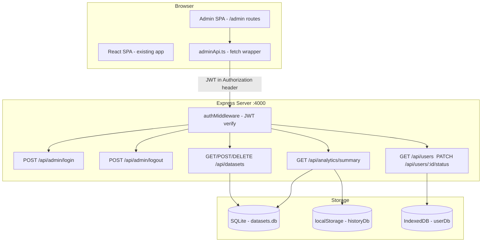

# Design Document: Admin Panel

## Overview

The Admin Panel extends the existing AI-Based Natural Language Data Analysis System with a protected administrative interface. It introduces a Node.js + Express backend (`server/`) alongside the existing Vite + React frontend, connected via a Vite dev-proxy. The admin panel lives at `/admin` in the React SPA and is guarded by JWT-based session tokens issued by the Express server.

Key design decisions:
- **Backend**: Node.js + Express with `better-sqlite3` for persistent storage of datasets, analytics cache, and admin sessions.
- **Auth**: Admin credentials stored in `.env` (`ADMIN_EMAIL`, `ADMIN_PASSWORD`). Sessions use signed JWTs (HS256) stored in `localStorage` on the client.
- **Frontend routing**: React Router v6 with a `<ProtectedAdminRoute>` wrapper. All admin pages live under `src/admin/`.
- **Data sources**: Analytics pull from both uploaded datasets (SQLite) and the existing `historyDb` (localStorage) and `userDb` (IndexedDB).
- **Charts**: Recharts (already installed) for all visualizations.
- **Dark mode**: Reads/writes the same `theme` localStorage key used by the main app.
- **i18n** (optional): `react-i18next` with English, Hindi, and Tamil locale files.

---

## Architecture



The Vite dev server proxies `/api` to `http://localhost:4000` so the frontend never needs to hard-code the backend URL. In production, a reverse proxy (nginx / same-origin deployment) handles this.

---

## Components and Interfaces

### Frontend (`src/admin/`)

```
src/admin/
  AdminApp.tsx              # Root admin router, theme sync, auth context
  AdminAuthContext.tsx      # React context: token, adminUser, login/logout helpers
  adminApi.ts               # Typed fetch wrapper that injects JWT header
  pages/
    LoginPage.tsx           # Admin login form
    DashboardPage.tsx       # Metric cards + quick stats
    QueryAnalyzerPage.tsx   # NL query input, SQL preview, results, charts
    DatasetsPage.tsx        # Upload, list, schema viewer, delete
    HistoryPage.tsx         # Filterable query history table
    AnalyticsPage.tsx       # Pre-built Recharts charts
    UsersPage.tsx           # User list, search, deactivate
    InsightsPage.tsx        # AI-generated insight cards
  components/
    AdminSidebar.tsx        # Persistent nav, mobile drawer
    AdminNavbar.tsx         # Top bar with user name + dark mode toggle
    ProtectedAdminRoute.tsx # Redirects to /admin/login if no valid token
    MetricCard.tsx          # Reusable stat card
    InsightCard.tsx         # Titled insight with impact badge
    DatasetSchemaTable.tsx  # Column/type table renderer
```

### Backend (`server/`)

```
server/
  index.ts                  # Express app entry, middleware setup
  routes/
    auth.ts                 # POST /api/admin/login, POST /api/admin/logout
    datasets.ts             # CRUD for datasets
    analytics.ts            # GET /api/analytics/summary
    users.ts                # GET /api/users, PATCH /api/users/:id/status
  middleware/
    authMiddleware.ts       # JWT verification, attaches req.admin
    validateBody.ts         # Zod-based request body validation
  db/
    sqlite.ts               # better-sqlite3 connection + schema init
  services/
    datasetService.ts       # CSV/JSON parse, schema inference, SQLite storage
    analyticsService.ts     # Aggregation queries over datasets + historyDb bridge
```

### Key Interfaces

```typescript
// Shared types (server/types.ts and mirrored in src/admin/types.ts)

interface AdminTokenPayload {
  sub: 'admin';
  iat: number;
  exp: number;
}

interface DatasetMeta {
  id: string;           // UUID
  name: string;
  format: 'csv' | 'json';
  rowCount: number;
  columnCount: number;
  uploadedAt: number;   // Unix ms
}

interface DatasetSchema {
  datasetId: string;
  columns: Array<{ name: string; type: 'string' | 'number' | 'boolean' | 'date' }>;
}

interface AnalyticsSummary {
  totalQueries: number;
  totalDatasets: number;
  totalUsers: number;
  querySuccessRate: number;   // 0–100
  salesByCity: Array<{ city: string; total: number }>;
  salesByCategory: Array<{ category: string; total: number }>;
  monthlyTrend: Array<{ month: string; value: number }>;
}

interface UserRecord {
  id: number;
  name: string;
  email: string;
  createdAt: number;
  lastLogin: number;
  isActive: boolean;
}

interface InsightCard {
  title: string;
  summary: string;
  explanation: string;
  impactLevel: 'High' | 'Medium' | 'Low';
  recommendedActions: string[];
  followUpQueries: string[];
}
```

---

## Data Models

### SQLite Schema (`datasets.db`)

```sql
-- Stores dataset metadata
CREATE TABLE IF NOT EXISTS datasets (
  id          TEXT PRIMARY KEY,
  name        TEXT NOT NULL,
  format      TEXT NOT NULL CHECK(format IN ('csv','json')),
  row_count   INTEGER NOT NULL,
  col_count   INTEGER NOT NULL,
  uploaded_at INTEGER NOT NULL
);

-- Stores inferred column schema per dataset
CREATE TABLE IF NOT EXISTS dataset_columns (
  dataset_id  TEXT NOT NULL REFERENCES datasets(id) ON DELETE CASCADE,
  col_name    TEXT NOT NULL,
  col_type    TEXT NOT NULL,
  PRIMARY KEY (dataset_id, col_name)
);

-- Stores actual dataset rows as JSON blobs for query context
CREATE TABLE IF NOT EXISTS dataset_rows (
  id          INTEGER PRIMARY KEY AUTOINCREMENT,
  dataset_id  TEXT NOT NULL REFERENCES datasets(id) ON DELETE CASCADE,
  row_data    TEXT NOT NULL  -- JSON object per row
);

-- Tracks invalidated JWT tokens (for logout)
CREATE TABLE IF NOT EXISTS revoked_tokens (
  jti         TEXT PRIMARY KEY,
  revoked_at  INTEGER NOT NULL
);

-- Caches analytics aggregations (TTL-based)
CREATE TABLE IF NOT EXISTS analytics_cache (
  key         TEXT PRIMARY KEY,
  value       TEXT NOT NULL,  -- JSON
  computed_at INTEGER NOT NULL
);
```

### localStorage / IndexedDB (existing, read-only from admin)

The Express server cannot directly read browser storage. The analytics endpoint bridges this gap:
- **Query history metrics** (total count, success rate) are computed client-side in `adminApi.ts` from `historyDb.getAll()` and sent as part of the dashboard fetch payload, OR the admin frontend reads them directly and merges with server-side dataset metrics.
- **User records** are read from IndexedDB via a dedicated `/api/users` endpoint that the frontend populates by calling `userDb.getAllUsers()` and POSTing the snapshot — OR the server reads a SQLite mirror that is updated on each user registration (preferred for server-side filtering).

Design decision: The Express server maintains a **SQLite mirror** of user accounts. When a user registers or logs in via the existing `userDb`, the frontend also calls `POST /api/users/sync` with the user record. This keeps the server authoritative for user management without replacing IndexedDB.

### Admin Credentials

Stored only in `.env`:
```
ADMIN_EMAIL=admin@example.com
ADMIN_PASSWORD=changeme
JWT_SECRET=<random-256-bit-hex>
```

Never stored in the database. Compared at login time using `crypto.timingSafeEqual` to prevent timing attacks.

---

## Correctness Properties

*A property is a characteristic or behavior that should hold true across all valid executions of a system — essentially, a formal statement about what the system should do. Properties serve as the bridge between human-readable specifications and machine-verifiable correctness guarantees.*

### Property 1: Protected routes require authentication

*For any* Admin Panel route path, a request made without a valid JWT session token should result in a redirect to `/admin/login` and the protected content should not be rendered.

**Validates: Requirements 1.1, 1.2**

---

### Property 2: Invalid credentials produce generic error messages

*For any* combination of email and password that does not match the admin credentials, the login response should contain an error message that does not distinguish between a wrong email and a wrong password.

**Validates: Requirements 1.4**

---

### Property 3: Login then logout clears session

*For any* successful admin login, performing a logout should result in no active session token in localStorage and subsequent requests to protected endpoints should return HTTP 401.

**Validates: Requirements 1.5, 1.7**

---

### Property 4: Active session token is included in all API requests

*For any* API request made while an admin session is active, the request should include a valid `Authorization: Bearer <token>` header.

**Validates: Requirements 1.8**

---

### Property 5: Dashboard metric counts match actual data

*For any* state of the system (N queries in history, M datasets stored, K users registered), the Dashboard should display counts equal to N, M, and K respectively, and the success rate should equal (successful queries / N) × 100.

**Validates: Requirements 2.1, 2.2, 2.3, 2.4**

---

### Property 6: Query results are always rendered in tabular format

*For any* valid response from the Gemini Service containing result data and optimization feedback, the Query Analyzer should render the data rows in a table and display the optimization feedback text alongside the generated SQL.

**Validates: Requirements 3.3, 3.8**

---

### Property 7: Visualization type matches Gemini suggestion

*For any* Gemini Service response with a visualization suggestion of `bar`, `line`, `pie`, or `area`, the Query Analyzer should render the corresponding Recharts chart component type.

**Validates: Requirements 3.4**

---

### Property 8: Query errors preserve user input

*For any* error thrown by the Gemini Service, the Query Analyzer should display a descriptive error message and the text input field should still contain the original query text.

**Validates: Requirements 3.5**

---

### Property 9: Successful queries are recorded in history with all required fields

*For any* query that completes successfully, the History Store should contain an entry with the natural language query, generated SQL, result row count, and execution time in milliseconds.

**Validates: Requirements 3.6**

---

### Property 10: Active dataset context replaces default schema in Gemini prompts

*For any* selected dataset, the context object passed to the Gemini Service should contain the dataset's schema columns and not the default `DB_SCHEMA` constant.

**Validates: Requirements 3.7**

---

### Property 11: Dataset upload round-trip preserves schema

*For any* valid CSV or JSON file upload, parsing the file to infer a schema, storing it, retrieving it, and re-parsing the retrieved schema should produce an equivalent schema object (same column names and inferred types).

**Validates: Requirements 4.2, 4.3, 4.10**

---

### Property 12: Invalid file uploads are rejected

*For any* file that is not valid CSV or JSON, or that exceeds 10 MB, the Dataset Manager should reject the upload and return a descriptive error without storing any data.

**Validates: Requirements 4.4, 4.5**

---

### Property 13: Dataset list renders all required metadata fields

*For any* collection of stored datasets, the rendered dataset list should display name, format, row count, column count, and upload date for every entry.

**Validates: Requirements 4.6**

---

### Property 14: Dataset deletion removes entry from list

*For any* stored dataset, confirming deletion should result in the dataset no longer appearing in the dataset list and its schema no longer being retrievable from the server.

**Validates: Requirements 4.8**

---

### Property 15: Schema pretty-printer renders all columns and types

*For any* dataset schema object, the rendered schema table should contain a row for every column with both the column name and its inferred type visible.

**Validates: Requirements 4.9**

---

### Property 16: Combined history filters are conjunctive

*For any* combination of active filters (search text, date range, status), every displayed history entry should satisfy all active filter conditions simultaneously.

**Validates: Requirements 5.3, 5.4, 5.5, 5.6**

---

### Property 17: History entries are displayed in reverse chronological order

*For any* history store with multiple entries, the displayed list should be ordered such that each entry's timestamp is greater than or equal to the timestamp of the entry that follows it.

**Validates: Requirements 5.8**

---

### Property 18: History list renders all required fields

*For any* history store, the rendered list should display the natural language query, generated SQL, execution time, timestamp, and status for every entry.

**Validates: Requirements 5.1**

---

### Property 19: User list renders all required fields including status

*For any* collection of user records, the rendered user list should display name, email, registration date, last login date, and account status (active or inactive) for every user, and the total count shown should equal the number of users.

**Validates: Requirements 7.1, 7.2, 7.6**

---

### Property 20: User search filter is case-insensitive

*For any* search string and user collection, every displayed user should have a name or email that contains the search string when both are lowercased.

**Validates: Requirements 7.3**

---

### Property 21: Deactivated users cannot log in

*For any* user account that has been deactivated via the User Manager, a login attempt with that user's credentials should be rejected by the server.

**Validates: Requirements 7.4, 7.5**

---

### Property 22: Insight cards render all required fields

*For any* valid Gemini insights response, each insight card should display a title, summary, explanation, impact level indicator, and recommended actions.

**Validates: Requirements 8.2, 8.5**

---

### Property 23: Dataset context is included in AI insights prompts

*For any* active dataset selection, the prompt sent to the Gemini Service for insights should include the dataset's schema columns and a sample of its rows.

**Validates: Requirements 8.4**

---

### Property 24: Sidebar navigation renders the correct section

*For any* sidebar navigation link, clicking it should result in the corresponding page component being rendered and that link being visually marked as active.

**Validates: Requirements 9.2, 9.3**

---

### Property 25: Dark mode preference persists in localStorage

*For any* dark mode toggle action, the `theme` key in localStorage should be updated to reflect the new state, and the value should be the same key used by the main application.

**Validates: Requirements 10.4**

---

### Property 26: Protected API endpoints return 401 without valid token

*For any* protected Express endpoint and any request made without a valid JWT (missing, expired, or revoked), the server should return HTTP 401 with a descriptive error message.

**Validates: Requirements 11.9**

---

### Property 27: Invalid request bodies return 400 with field-level errors

*For any* request to an Express endpoint with a body that fails schema validation, the server should return HTTP 400 with an error response that identifies the specific invalid fields.

**Validates: Requirements 11.10**

---

### Property 28: Analytics summary values are computed correctly

*For any* dataset and history state, the `/api/analytics/summary` endpoint should return `totalQueries`, `totalDatasets`, `totalUsers`, and `querySuccessRate` values that match the actual counts and formula in the data stores.

**Validates: Requirements 11.6**

---

## Error Handling

### Authentication Errors
- Invalid credentials: return generic "Invalid credentials" message (no field-level hint). HTTP 401.
- Missing/expired JWT: middleware returns HTTP 401 with `{ error: "Unauthorized" }`.
- Revoked token (post-logout): checked against `revoked_tokens` table. HTTP 401.

### Dataset Upload Errors
- Wrong MIME type / unparseable content: HTTP 400 with `{ error: "Invalid file format. Only CSV and JSON are accepted." }`.
- File exceeds 10 MB: HTTP 413 with `{ error: "File too large. Maximum size is 10 MB." }`.
- Parse failure mid-stream: transaction rolled back, no partial data stored.

### Gemini Service Errors
- Network/API error: caught in `try/catch`, error message displayed in UI, input preserved.
- Malformed JSON response: fallback error message shown, retry button available.
- Rate limit (429): specific message "AI service is temporarily unavailable. Please try again shortly."

### Express Server Errors
- Zod validation failure: HTTP 400 with `{ errors: [{ field, message }] }` array.
- SQLite constraint violation: HTTP 409 with descriptive message.
- Unhandled exceptions: global error handler returns HTTP 500 with `{ error: "Internal server error" }` (no stack trace in production).

### Offline / Connectivity
- Dashboard fetch failure: last successful metrics cached in `analytics_cache` table (TTL 5 minutes). UI shows yellow warning banner "Using cached data — server unreachable."

---

## Testing Strategy

### Dual Testing Approach

Both unit tests and property-based tests are required. They are complementary:
- **Unit tests** cover specific examples, integration points, and edge cases.
- **Property-based tests** verify universal correctness across all valid inputs.

### Technology Stack

| Layer | Framework |
|---|---|
| Frontend unit + property tests | Vitest + React Testing Library + `fast-check` |
| Backend unit + property tests | Vitest (Node) + `fast-check` |
| API integration tests | Vitest + `supertest` |

`fast-check` is the chosen property-based testing library for both frontend and backend. Each property test must run a minimum of **100 iterations**.

### Unit Test Coverage

Focus areas:
- `adminApi.ts`: verify JWT header injection, error propagation
- `datasetService.ts`: CSV/JSON parse, schema inference for known inputs
- `analyticsService.ts`: aggregation formula with known fixture data
- `authMiddleware.ts`: valid token passes, expired token rejected, revoked token rejected
- `LoginPage.tsx`: form submission, error display
- `HistoryPage.tsx`: initial load, expand/collapse entry
- `InsightsPage.tsx`: retry button on error, follow-up query click
- `AdminSidebar.tsx`: all 7 nav links present, mobile drawer open/close

### Property-Based Test Specifications

Each property test must include a comment tag in the format:
`// Feature: admin-panel, Property N: <property_text>`

| Property | Test Description | Generator |
|---|---|---|
| P1 | Protected routes redirect without token | Arbitrary route path strings |
| P2 | Invalid credentials give generic error | Arbitrary email/password pairs |
| P3 | Login→logout clears session | Valid credential fixture |
| P4 | Active session includes auth header | Arbitrary API endpoint paths |
| P5 | Dashboard counts match actual data | Arbitrary N queries, M datasets, K users |
| P6 | Query results render table + feedback | Arbitrary valid Gemini response objects |
| P7 | Chart type matches suggestion | Arbitrary enum values from {bar,line,pie,area} |
| P8 | Errors preserve input text | Arbitrary query strings + error objects |
| P9 | Successful queries recorded with all fields | Arbitrary query + response pairs |
| P10 | Dataset context replaces default schema | Arbitrary dataset schema objects |
| P11 | Dataset upload round-trip | Arbitrary CSV/JSON content generators |
| P12 | Invalid uploads rejected | Arbitrary invalid file content + oversized buffers |
| P13 | Dataset list shows all metadata | Arbitrary arrays of DatasetMeta objects |
| P14 | Deletion removes from list | Arbitrary dataset collections |
| P15 | Schema pretty-printer shows all columns | Arbitrary DatasetSchema objects |
| P16 | Combined filters are conjunctive | Arbitrary history arrays + filter combinations |
| P17 | History in reverse chronological order | Arbitrary history arrays with random timestamps |
| P18 | History list shows all fields | Arbitrary HistoryItem arrays |
| P19 | User list shows all fields + count | Arbitrary UserRecord arrays |
| P20 | User search is case-insensitive | Arbitrary search strings + user arrays |
| P21 | Deactivated users cannot log in | Arbitrary user records marked inactive |
| P22 | Insight cards show all fields | Arbitrary InsightCard arrays |
| P23 | Dataset context in insights prompt | Arbitrary dataset + schema objects |
| P24 | Sidebar nav renders correct section | Arbitrary nav link selections |
| P25 | Dark mode persists in localStorage | Arbitrary toggle sequences |
| P26 | Protected endpoints return 401 without token | Arbitrary protected endpoint paths |
| P27 | Invalid bodies return 400 with field errors | Arbitrary malformed request bodies |
| P28 | Analytics summary computed correctly | Arbitrary dataset + history state |

### Edge Cases (Unit Tests)

- Empty history store → success rate displays as 0% or N/A
- Dataset with 0 rows → schema inferred from headers only
- File exactly at 10 MB boundary → accepted; 1 byte over → rejected
- Gemini returns `visualizationSuggestion: 'none'` → no chart rendered
- All users deactivated → user list shows 0 active
- Missing i18n translation key → falls back to English string
- Browser without Web Speech API → microphone button hidden
